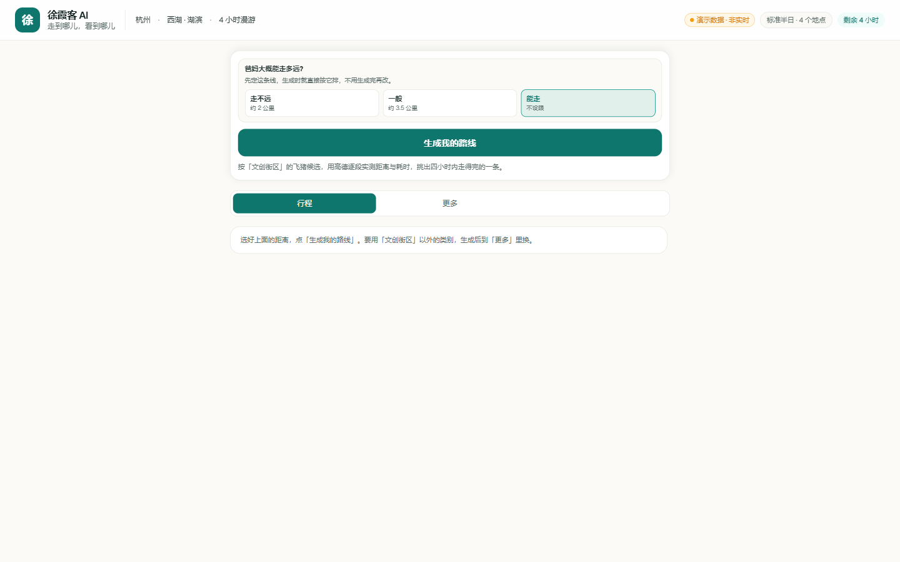
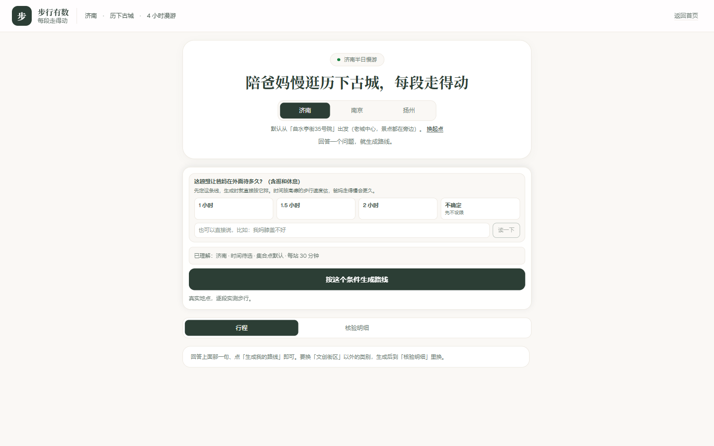
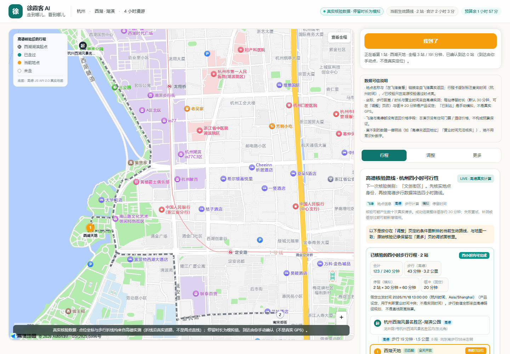
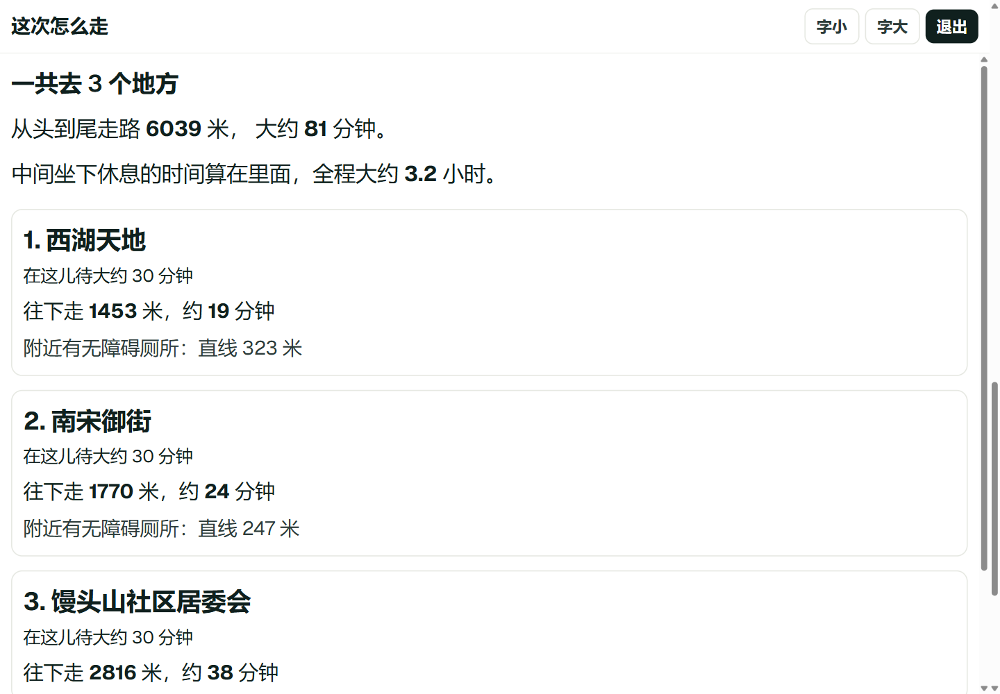
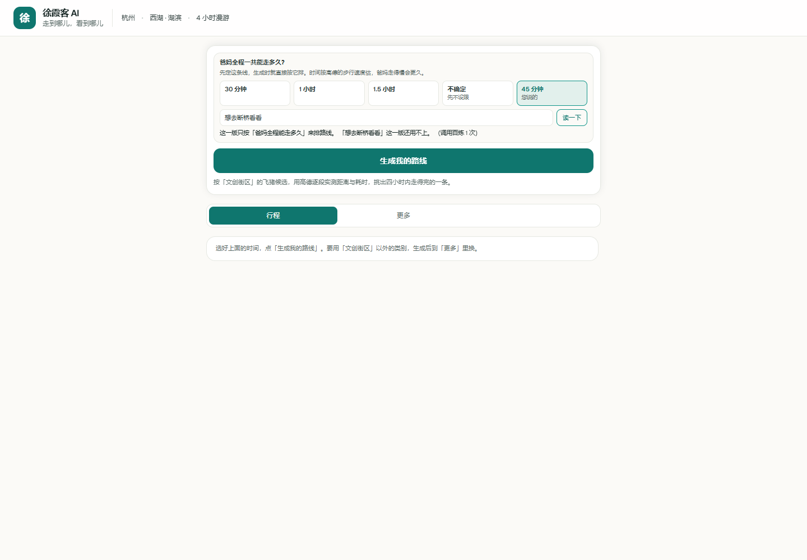
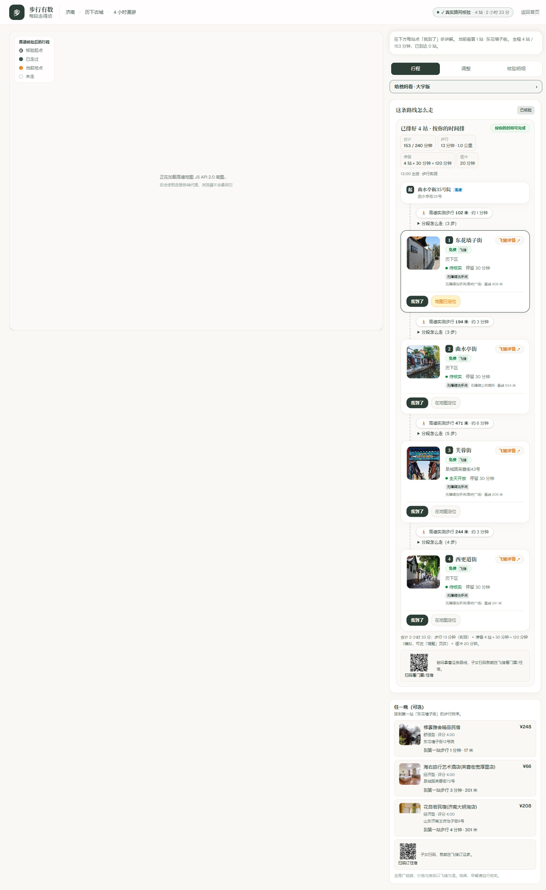

# 参赛投稿正文（定稿 · 2026-11-26）

团队：未竟工作室。

---

## 参赛项目名称

**步行有数 · 带爸妈出行的路线协商助手**

> 把「爸妈走不动」变成能算的条件，然后摊开给你看。

参赛方向：目的地探索。

---

## 团队 / 作者与奖品领取人

- 团队名称：未竟工作室
- 主要提交人 GitHub ID（必填、唯一奖品领取人）：[@hxrhsq](https://github.com/hxrhsq)
- 其他成员：本次未登记其他署名

---

## 旅行场景与目标用户

**目标用户**：带父母或祖辈出游的成年子女。

**那个具体场景**：你带爸妈玩杭州，问「咱们再多逛一个地方吧」，他们说「行啊」。
然后走了两百米，开始找椅子。

这个矛盾**不是信息不够**。再生成一版攻略解决不了它——攻略告诉你「去哪」，不告诉你「这一趟到底要走多少米」。
真正的矛盾是：**想多逛的人和走不动的人，坐在同一张桌子上。**

**为什么是我们这个角度**：截至本文更新（2026-11-25），官方 Issue 区带比赛标签的公开投稿 44 份
（含窗口关闭后补交的 12 份），绝大多数在解决「怎么规划得更好」。
我们解决的是另一件事——**不同人的限制怎么同时成立**。
这个题不是靠更好的模型，是靠把限制变成可计算、可核对、可修改的东西。

**范围（刻意压窄，不贪）**：

- **17 个城市可核验，但首页只放 3 个实测达标的**：济南、南京、扬州。
  「达标」的定义见下文：把「一口气最多走 900 米」收紧后，仍能排出不少于 3 站。
- 只有半日（240 分钟预算）、只做目的地探索。没有酒店比价，没有全国城市的承诺，没有评分体系。

---

## 我做了什么

### 一句话，变成一张能核对的卡

用户在首页说一句关于爸妈体力的话。系统不直接给行程，先给一张卡。下面两组都是实测过的原话与实测结果（不是示意图）：

```
输入「走半小时就累，但全程加起来一个半小时没问题」
☑ 爸妈全程能走约 90 分钟   ← 逐字摘录「全程加起来一个半小时没问题」，1.5 小时由代码换算；模型没给过任何数字

输入「我妈膝盖不好，想去河坊街」
☐ 这句话算不出时长，追问一句：爸妈全程一共大概能走多久？
   另外记下：想去河坊街（与能走多久无关，不参与换算）
```

含糊说法同样不换算：同一份探针里「半天都行吧」的结果是 `got:"ask"`、`minutes:null`——系统追问，
而不是替用户编出一个 90 分钟。读不成也不硬给数字，只会退回手动档位（40 条探针里有 6 条模型判断与预期不一致，
例如「膝盖不好，一共最多走半小时」被判成追问；这一条的实测结论写进探针记录，不粉饰成 40/40）。

**关键设计：数字不由模型给。**
模型只做两件事——判断这句话属于哪一类、写一句追问。
凡是出现的分钟数，都由代码从用户原话里逐字摘出来算；
摘不出原文就追问，**不猜、不换算**。

> 实测依据：40 条真实语句探针，硬性校验 40/40 通过，
> 模型判断与预期完全一致 34/40 —— 剩下 6 条正是靠代码兜底纠正的。
> 见 [understand-real-probe.json](https://github.com/hxrhsq/buxingyoushu/blob/main/evidence/understand-real-probe.json)

### 两个独立的步行约束，不是一个

大多数工具只有一个「总步行上限」。我们做了两个，因为它们解决不同问题：

| 约束 | 解决什么 |
|---|---|
| **全天总步行上限** | 一天下来别累垮 |
| **单段最长连续步行** | 总量够短，也可能中间有一段走不动 |

一条 4 公里的路线，如果有一段连着走 1.2 公里，对膝盖不好的人照样不行。
这两个条件各自独立生效，服务端按高德**逐段实测值**判断。

先说清两个容易混的数字：**240 分钟是半日行程的总预算**（含每站停留与缓冲），
**「爸妈能走多久」约束的是步行本身**。两者分开生效，所以会出现「总行程 2 小时 33 分、
实际步行只有 13 分钟」的路线——那正是给走不动的人排的：坐得多，走得少。
大字版里会把这两个数字分开写明，不让老人自己猜。

### 改条件不花钱

**这是整个项目最重要的一个数字。**

核验要花钱（真实高德调用）。但改主意不该再花钱。

核验时付费测过的每一段路都留在事实层里，之后改上限是**本地重解**：

> 真机验收（2026-11-18，亲情版）：一次核验 37 次高德调用、1 次飞猪查询，
> 之后连续 6 次改条件——**新增 0 次**。
> 见 [family-real-accept.json](https://github.com/hxrhsq/buxingyoushu/blob/main/evidence/family-real-accept.json)（38/38 通过）
>
> 另一轮单人版验收：一次核验 27 次高德调用，之后连续三次改上限 **0 / 0 / 0**。
> 见 [solo-resolve-accept.json](https://github.com/hxrhsq/buxingyoushu/blob/main/evidence/solo-resolve-accept.json)

界面上直接写「本次重解新增高德调用：0 次（复用已实测路段）」——
这是我们自己的承诺，也由我们自己证明。

### 算不出来时，说清是哪条卡住的

不是丢一句「未找到可行路线」，而是：

> 按当前条件最多只能排 1 个站（集贤亭），少于半日游最少需要的 2 站。
> **取消单段上限后能排到 4 站，说明是「一口气最多走 400 米」把站点压掉了。**

用户因此知道该改哪个数字。这不是边缘功能——下面多城市实测里，
杭州正是因为这个机制才能诚实地写「不达标」。

### 多城市实测：17 城跑过，首页只放 3 城，跑不通的也写出来

给「能走多久有限」的人做产品，唯一的外凭证是真实路线数据。所以我们把候选城市逐个真跑了一遍：

- **17 座城市，每城一次真实核验**，类别固定「文创街区」，全部走高德免费额度（本轮合计约 160 次 place + 430 次 walking，**0 元**）；
  原始记录逐城落盘（脚本生成，未手改），见仓库 `evidence/objective-compare-<城市>.json`。
- **首页三城（济南 / 南京 / 扬州）的默认路线本身就满足「每段 ≤900 米」**：

| 城市 | 默认路线（站数 / 总步行 / 最长单段） | 收紧到 900 米后 |
|---|---|---|
| 济南（默认） | 4 站 / 1011 米 / 471 米 | 4 站不变 |
| 南京 | 4 站 / 1741 米 / 668 米 | 4 站不变（老门东、小西湖、乌衣巷、夫子庙，4 个不同景点） |
| 扬州 | 4 站 / 2077 米 / 680 米 | 4 站不变（花局里、古琴第一街、东圈门、彩衣街） |

- **收紧口径（G4）达标 7 座**：济南、南京、扬州、青岛、长沙、福州、太原（换起点）。
  其中福州 4 站全部是「三坊七巷-XX巷」，体验上像同一片景区拆成 4 个点；太原换起点后起点位置存疑——
  这两条异常都写进了实测报告，不在正文里洗掉。
- **不进预设 10 座**：杭州、苏州、无锡、绍兴、广州、西安、天津、宁波、泉州、沈阳。
  每一座都记录了卡在哪条门槛（如沈阳最长单段 3173 米超过 2500 米上限；无锡收紧后最多排 1 站）。
  **不塞点、不放宽阈值、不用模拟数据顶替——跑不通是有效产出，结论如实记录。**
- 判定门槛共 6 条（G1 起点必须是街区本体、G2 可排站数、G3 默认路线单段上限、G4 收紧口径、G5 营业时间冲突、
  G6 厕所标注仅记录不当卖点），口径与逐城结论见 [city-trial-2026-11-22.md](https://github.com/hxrhsq/buxingyoushu/blob/main/evidence/city-trial-2026-11-22.md)。
- 未实测的城市不写进任何宣传：上海、北京、成都、深圳经交接评估判定候选散在几十公里，**未跑**；
  其余未列城市一律未实测。

### 给爸妈看的大字版

同一个手机，点一下切到另一套界面：只讲去哪几个地方、走多久、厕所在哪。
字号 1.0–1.8 倍可调，最小 22px 实测。

去掉的东西：来源标签、正负号差异、技术证明。
保留的东西：诚实口径，用大白话写。

> 界面与验收依据：[elder-view-accept.json](https://github.com/hxrhsq/buxingyoushu/blob/main/evidence/elder-view-accept.json)（23/23）、
> [ui-density-accept.json](https://github.com/hxrhsq/buxingyoushu/blob/main/evidence/ui-density-accept.json)（63/63，2026-11-21 轮，含讲解按站归属与「我到了」竞态回归）

### 沿途无障碍洗手间

每站标出最近的高德标注无障碍洗手间与**直线距离**（半径 800 米内）。

**我们明确不做的事**：高德公开分类体系里只有「无障碍洗手间」这一个**点**（分类码 200303），
没有坡道、台阶、盲道、坡度的**路**数据。
所以我们**不承诺「整条路线轮椅可通行」**——验证不了的，我们不说。

---

## 百炼使用说明（必填）

### 在运行时链路的哪里

**只用在两处，都在产品运行时**，没有用在开发链路。

#### ① 读「说说爸妈的情况」那一句话 —— OpenAI 兼容接口

| 项 | 内容 |
|---|---|
| 调用方式 | **API 直连**：`https://{workspace}.cn-beijing.maas.aliyuncs.com/compatible-mode/v1/chat/completions` |
| 模型 | **`qwen-flash`**（默认关思考模式，非思考模式支持 json_object） |
| 强制格式 | `response_format: json_object`、`temperature: 0` |
| 输入 | 用户原话（≤200 字）+ 系统提示里的 7 条判断规则 |
| 输出 | `{ kind: "total" \| "ask" \| "off-topic", quote, question, other[] }` |
| 服务端复验 | `quote` 必须逐字出现在用户原文里，否则作废；`question` 里不许出现用户没提过的时长或距离，否则换成默认问题 |
| 失败处理 | 超时/报错/格式不合法 → 退回默认追问，**不拿固定文案冒充模型返回** |
| 成本控制 | 独立小时上限 60 次，超限直接拒绝、不发请求 |
| 隐私 | 用户原话只发给百炼，不写日志；日志只留时间、状态码、耗时、token 数 |

**为什么选直连而不是托管智能体**：这里只需要「分类 + 一句追问」，
托管智能体一回合要建会话、订阅 SSE、提交消息三次请求，也没法强制返回固定格式。

#### ② 到站讲解 / 解释取舍 —— 百炼托管智能体

| 项 | 内容 |
|---|---|
| 调用方式 | **Managed Agent HTTP API**：`https://{workspace}.{region}.maas.aliyuncs.com/api/v1/agentstudio`，`agent_with_overrides` |
| 会话 | 服务端管理会话，`disableTools: true`、会话级 system 注入常驻规则 |
| 输入 | 当前已核实路线、站点事实、高德实测的每段距离与耗时 |
| 输出 | 讲解文本；其中每个「米 / 分钟」都与服务端实测值逐条比对，对不上的当场标为未匹配 |
| 边界 | 模型**不能改任何人的硬条件**，**不能碰路线数字**，失败时如实展示错误并保留规则求解结果 |

多城市扩展只改了城市注册表与前端文案，百炼侧模型与提示未动。

### 其他技术栈

Next.js 16（App Router + Turbopack）· React 19 · TypeScript · Tailwind CSS v4
· 高德 Web 服务 v5（`place/text`、`direction/walking`）· 飞猪 FlyAI CLI（`search-poi`）
· 高德 JS API 2.0（地图展示）

### 三家的分工

| 服务 | 提供什么 | 我们的用法 |
|---|---|---|
| **飞猪 FlyAI** | 候选地点：名称、地址、坐标、飞猪链接、id | 核验第一步的候选池；每站 id 再代码复验一次真伪 |
| **高德 Web 服务** | POI 检索、逐段步行距离与折线、无障碍洗手间分类 | **所有判断的数字都来自这里** |
| **百炼** | 语言理解、讲解、解释 | 只翻译与解释，**不碰数字、不碰硬条件** |

---

## 效果展示

> 以下截图为线上 Demo（bxys.peiqirui.com）当前版本的界面。

### 1. 首页只有一件事：选城市、问爸妈能走多久




### 2. 真实路线：每段步行距离都摊开写

只留站名、飞猪链接、地址、停留时长、营业状态、无障碍洗手间距离，
以及每站内嵌的「我到了」。



### 3. 到站讲解：数字与实测逐条对过

点任意一站的「我到了」，百炼托管智能体按已核实路线讲这一站；
讲解里出现的每个距离、时长都与服务端实测值比对，对不上当场标出。
（在线体验：Demo 里生成任意一条路线即可试。）

### 4. 给爸妈看的大字版



### 5. 一句话读条件（真实探针）



### 6. 路线旁的住宿入口



**演示视频**：录制中，提交前补入本节。

---

## 项目链接与复现方式

- 仓库：[步行有数源码仓库](https://github.com/hxrhsq/buxingyoushu)（MIT）
- Demo：**https://bxys.peiqirui.com**（线上即当前版本，亲情版 + 三城首页）
- 运行与配置见仓库 README

**体验步骤**：

1. 首页三城选一（默认济南），或直接说一句「带我妈去南京，她膝盖不好」
2. 点「按这个条件生成路线」——首次会真实调用飞猪与高德（约 37 次，成本提示见下）
3. 到「调整」页改总步行或单段上限，观察行程变化与「本次新增高德调用：0 次」
4. 点「给爸妈看 · 大字版」切到大字版
5. 每站点「我到了」听百炼讲解

**成本提示**：首次核验是真实付费调用；之后在同一事实集上改条件免费。
「自然风光」类别会返回几十公里外的远郊景点导致排不出路线，**演示请用「文创街区」**。

### 边界与不做的事

- **无障碍**：只标高德「无障碍洗手间」标注点（直线距离），不承诺轮椅可通行（见上文）。
- **数据口径**：界面上的每条数据都标来源——飞猪真实调用、高德实测、产品设定三类分开；
  「已到达」是用户手动点击，不是真实 GPS。
- **商业边界（2026-11-22 核实，2026-11-26 复核）**：飞猪 AI 推广者身份已开通
  （淘宝实名 + 正式 API Key + 签署协议，符合官方入驻指南的全部前置条件），按品类分开说：
  - **酒店**：路线页的住宿入口跳飞猪官方下单页、带账号级归因参数；
    酒店搜索实测返回佣金金额字段——酒店分佣链路成立。
  - **站点（街区 / 目的地玩乐）**：官方指南写明分佣品类主要为酒店与度假，
    本项目站点是否计佣官方没有写明，实测 POI 返回也没有佣金字段——**不宣称景点分佣**。
  - 不给出未公开的佣金率与结算周期。没做的写「没做」，查不到的写「无证据」。

---

## 踩坑记录（可选）

### 1. 模型天生会编数字，所以数字不能交给它

最初想让模型直接读「膝盖不好」然后给出「最多走 2 公里」。
后来发现这个数字最后会显示成「在您定的 2 公里以内」——
**但用户从没说过 2 公里，是我们编的**，而且这条路线会通过所有校验，看起来完全正当。

现在的做法：模型只做分类和追问，**任何数字都由代码从原话里逐字摘出来算**；
摘不出原文就追问，不猜。

### 2. 「走不动」不是一个条件，是两个

只限总量会漏掉「中间有一段连着走 1.2 公里」的情况。
单段上限必须独立判定——这是我们后来才补的。

### 3. 不能每改一次主意就重新查一遍地图

不然「妈说太远了，改一下」这个动作，每次都要花几十次调用。
把实测事实与路线求解分开之后，改条件才变成 0 成本。

### 4. 把点说成路，就是编造

高德只有「无障碍洗手间」这一个 POI 标注点，没有路面无障碍数据。
我们最初想写「无障碍路线」，查过分类表 2499 条之后放弃了——
**做不到的事必须写在界面上，不能等用户到现场才发现。**

### 5. 界面像控制台，是因为把所有工程信息都摆在了外面

第一版首屏有 16 个可点按钮、1851 个字。
用户原话：「我看了都想吐」。

现在 6 个按钮、354 字，工程信息全部归档到「核验明细」。
**不是删掉，是分层。**

### 6. 地图默认显示在首页，是个错误

没有产品会在首页放一张地图。地图应该跟着行程出现，不是当封面。

### 7. 跑不通的城市也是产出，异常也是

17 城实测里留下了一批没有修的异常：太原默认起点落到「印象·富士体验中心」这类店名、
福州 4 站全是三坊七巷的巷子、「少走路」模式在 11 座城市里塌成 1 站。
这些都原样留在实测报告的异常清单里。
**如果只展示达标城市，评审看到的可信度是我们精心挑出来的，不是测出来的。**
